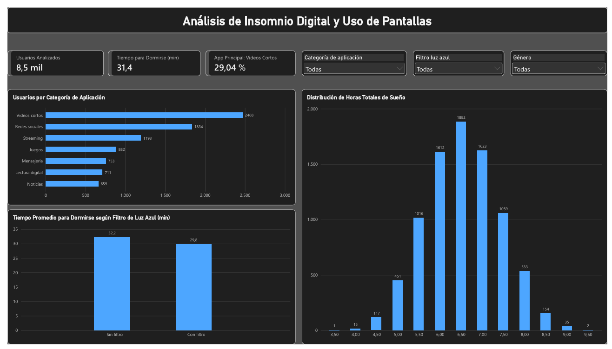

# Análisis de Insomnio Digital y Uso de Pantallas

**Autora:** Chiara Badaloni  
**Curso:** Herramientas Básicas para el Análisis de Datos — UTN BA  
**Cohorte:** Noviembre 2026  

## Objetivo del Proyecto
El presente Trabajo Final Integrador tiene como objetivo analizar el impacto de los hábitos nocturnos de uso de pantallas sobre la calidad y latencia del sueño en una muestra de **8.500 usuarios**, aplicando un flujo completo de limpieza, análisis exploratorio en Python y visualización interactiva en Power BI.

## Vista Previa del Dashboard

## Preguntas de Investigación
1. **Consumo por plataforma:** ¿Qué categorías de aplicaciones concentran la mayor cantidad de usuarios antes de dormir?
2. **Impacto del filtro de luz azul:** ¿Cómo varía el tiempo promedio necesario para conciliar el sueño (latencia) según el uso o no de filtros de luz azul?
3. **Distribución del descanso:** ¿Cuántas horas totales de sueño logra la mayoría de los usuarios analizados y qué proporción alcanza un descanso saludable?

## Fuente de Datos y Enlaces del Proyecto
* **Dataset original (Kaggle):** [Digital Insomnia: Screen Habits & Sleep](https://www.kaggle.com/datasets/beamhonor0911/digital-insomnia-screen-habits-sleep/data)
* **Datos crudos en el repositorio:** [`data/raw/sleep_debt_screen_time.csv`](./data/raw/sleep_debt_screen_time.csv)
* **Notebook de análisis en Python:** [`notebook/Sueño.ipynb`](./notebook/Sue%C3%B1o.ipynb)
* **Dashboard editable en Power BI:** [`dashboard/dashboard_sueno.pbix.pbix`](./dashboard/dashboard_sueno.pbix.pbix)
* **Vista previa del Dashboard (PDF):** [`dashboard/dashboard_sueno.pbix.pdf`](./dashboard/dashboard_sueno.pbix.pdf)
* **Vista previa del Dashboard (PNG):** [`dashboard/dashboard_sueno.png`](./dashboard/dashboard_sueno.png)

## Metodología y Pasos Realizados
1. **Limpieza y preparación (Google Colab):** Inspección de 8.500 registros mediante `pandas`, estandarización de variables categóricas al español, verificación de valores nulos y detección de valores atípicos.
2. **Análisis exploratorio (EDA):** Generación de estadísticas descriptivas y visualizaciones con `matplotlib` y `seaborn` para evaluar distribuciones de latencia y horas de descanso.
3. **Visualización ejecutiva (Power BI):** Diseño de un tablero oscuro con tres indicadores clave (KPI), tres gráficos principales y segmentadores interactivos por categoría de aplicación, filtro de luz azul y género.

## Principales Hallazgos
* **Predominio de videos cortos:** El **29,04%** de los usuarios (2.468 personas) utiliza aplicaciones de videos cortos como actividad principal antes de dormir, superando a redes sociales y streaming.
* **Latencia del sueño:** El tiempo promedio para dormirse es de **31,4 minutos**, registrándose una leve reducción en quienes utilizan filtro de luz azul (**29,8 min** frente a **32,2 min** sin filtro).
* **Horas de descanso:** La distribución del sueño total se concentra alrededor de las **6 a 7 horas diarias**, evidenciando una deuda de sueño generalizada frente a las 8 horas recomendadas.
